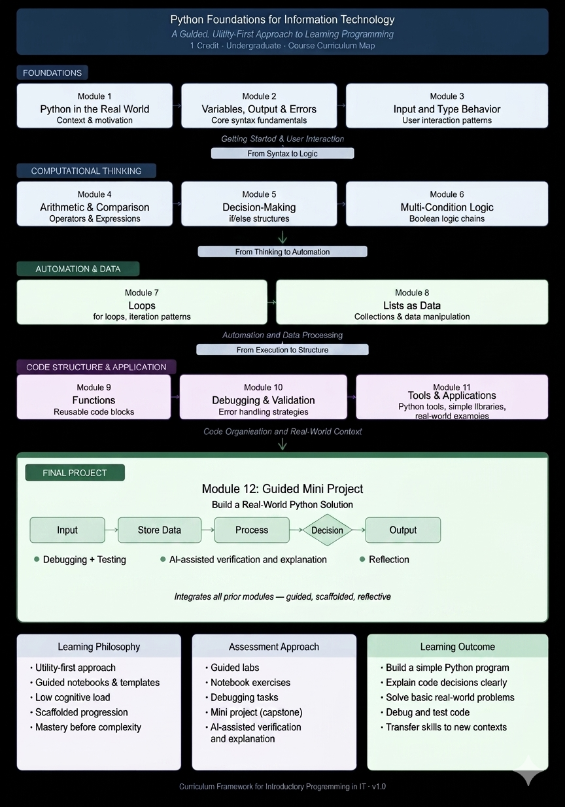

# Course Map

This map shows how the notebooks fit together. It is useful for instructors, students who want a big-picture view, and anyone reviewing the course structure.

The course includes a getting-started notebook followed by Modules 1-12.

## Module Map

| Module # | Module Name | Notebook File | Key Concepts | Skills Developed |
| --- | --- | --- | --- | --- |
| 0 | Getting Started | `notebooks/00_getting_started.ipynb` | Notebook workflow, running cells, checking output | Open notebooks, run code, build confidence |
| 1 | Python in the Real World | `notebooks/01_python_in_the_real_world.ipynb` | What Python is, practical uses, simple examples | Connect Python to real-world IT tasks |
| 2 | Variables, Output, and Errors | `notebooks/02_variables_output_errors.ipynb` | Variables, `print()`, basic error awareness | Store values, display output, notice simple mistakes |
| 3 | Input and Type Behavior | `notebooks/03_input_and_type_behavior.ipynb` | `input()`, strings, numbers, type conversion | Collect user input and prepare values for calculations |
| 4 | Arithmetic and Comparison | `notebooks/04_arithmetic_and_comparison.ipynb` | Math operators, comparison operators, order of operations | Calculate totals, compare values, check results |
| 5 | Decision Making | `notebooks/05_decision_making.ipynb` | `if`, `if-else`, decision rules | Write programs that choose different actions |
| 6 | Multi-Condition Logic | `notebooks/06_multi_condition_logic.ipynb` | Multiple conditions, `and`, `or` | Build simple rules with more than one condition |
| 7 | Loops | `notebooks/07_loops.ipynb` | Repetition, `for` loops, `range()` | Repeat actions and trace loop output |
| 8 | Lists as Data | `notebooks/08_lists_as_data.ipynb` | Lists, indexing, processing several values | Store related data and process it with loops |
| 9 | Functions | `notebooks/09_functions.ipynb` | Function definitions, calling functions, reusable steps | Organize repeated logic into simple functions |
| 10 | Debugging and Validation | `notebooks/10_debugging_and_validation.ipynb` | Error messages, testing, validation | Find mistakes, test changes, improve reliability |
| 11 | Python Tools and Applications | `notebooks/11_python_tools_and_applications.ipynb` | Light exposure to dictionaries, libraries, and next steps | Recognize additional Python capabilities without a mastery expectation |
| 12 | Guided Mini Project | `notebooks/12_guided_mini_project.ipynb` | Program workflow, integration, testing, reflection | Build and explain a small complete program |

## Optional Teaching Supports

Before continuing to Module 7, an instructor may replace Module 6's end reflection with the [mid-course check-in](templates/mid_course_reflection.md), retaining its real-world logic question. The [peer exchange or solo equivalent](docs/peer_learning.md) can replace the Comparing AND vs OR practice segment. [Stretch prompts](docs/stretch_prompts.md) are optional after the named lesson; they add no learning objectives or full-credit requirements. See the [instructor guide](INSTRUCTOR_GUIDE.md) for time budgeting and substitution details.

## OER Outcome Mapping

The [author-written OER learning outcomes](LEARNING_OUTCOMES.md) are the shared reference. This map describes the materials, not alignment certified by a university. Module objectives are unchanged.

| OER outcome | Supporting modules | Existing evidence of learning |
| --- | --- | --- |
| 1. Read and predict | 0–10 | Predict-before-running prompts, output explanations, and tracing examples |
| 2. Build small programs | 2–8, 12 | Guided changes, mini labs, and the small project |
| 3. Organize repeated tasks | 9 | Define and call a simple function with a parameter |
| 4. Test and explain changes | 2–10, 12 | Intentional-error practice, testing, and the project Fix Log |
| 5. Apply and reflect | 1, 4–10, 12 | Real-world connections, reflections, and project explanation |

Module 11 offers light exposure rather than additional mastery requirements. Functions are practiced in Module 9; this map does not add a function requirement to the final project. Adopters supply their own institutional alignment separately.

## Progression Summary

The course moves from basic notebook use to practical program building:

1. Start by running notebooks and reading output.
2. Store information with variables.
3. Get input and handle basic type behavior.
4. Calculate and compare values.
5. Make decisions with conditions.
6. Repeat actions with loops.
7. Store and process multiple values with lists.
8. Organize code with simple functions.
9. Debug, test, and validate work.
10. Combine course skills in a guided mini project.

The final goal is not advanced programming. The goal is for students to read, run, modify, test, and explain small Python programs with confidence.
